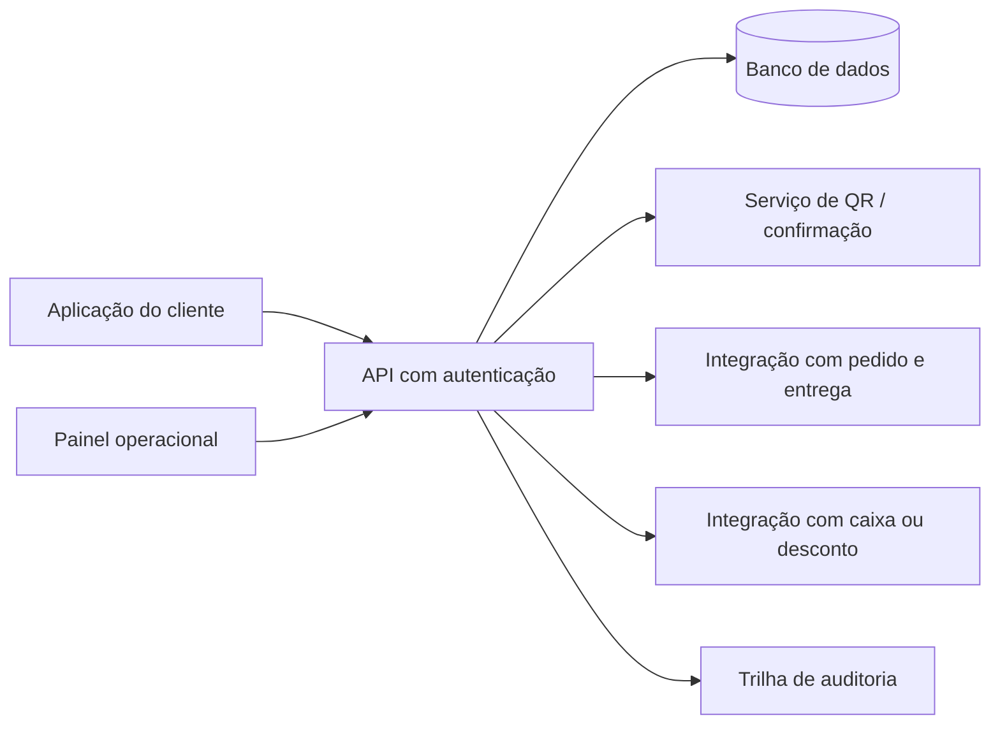

# Arquitetura do protótipo

## Visão geral atual

O protótipo é uma aplicação web estática, sem etapa de compilação:

| Arquivo | Responsabilidade |
|---|---|
| `index.html` | Estrutura das telas, formulários, tabelas e diálogos |
| `styles.css` | Cores, tipografia, componentes e adaptação para celular |
| `app.js` | Navegação, demonstração de regras, atualização das telas e armazenamento local |
| `assets/ecoloop-logo-transparent.png` | Marca exibida no menu |

O HTML carrega `QRCode.js` por CDN para desenhar os QR Codes. A câmera utiliza a API `BarcodeDetector` quando disponível. Por compatibilidade, há entrada manual do token.

## Fluxo técnico de uma recarga

1. O formulário cria um registro no navegador e calcula os pontos previstos com a taxa atual.
2. Um token aleatório acompanha o registro; o token é usado como conteúdo do QR.
3. A equipe marca a recarga como entregue.
4. O leitor obtém o token e procura a recarga salva localmente.
5. Se a recarga foi entregue e ainda não foi pontuada, o estado muda para creditado e o saldo aumenta.
6. O estado atualizado é escrito em `localStorage` e as telas são redesenhadas.

## Armazenamento

`localStorage` mantém a taxa, o saldo demonstrativo, as recargas e os resgates no navegador e perfil usados. Não sincroniza entre aparelhos ou pessoas. Os registros de exemplo são carregados quando não existe estado salvo.

## Dependências externas

- `qrcodejs` via jsDelivr: geração visual do QR Code.
- Google Fonts: fontes Manrope e DM Sans.

Sem internet, a interface principal continua disponível, mas QR e fontes externas podem não carregar. O token pode ser digitado no protótipo.

## Arquitetura recomendada para uma versão real

Essa arquitetura é apenas uma direção para estudo. A Ecojet e a equipe do projeto devem escolher plataformas, integrações, hospedagem e controles após levantamento de requisitos.

## Decisões necessárias antes de produção

- Estratégia de autenticação e recuperação de conta.
- Identificação do pedido e integração com o evento de entrega.
- Emissão e validação do QR no servidor, com expiração e idempotência.
- Registro contábil auditável para acumular, ajustar, estornar e resgatar pontos.
- Controle de acesso administrativo e histórico das alterações da taxa.
- Privacidade, retenção, consentimento e suporte ao titular dos dados.
- Disponibilidade móvel e operação em locais com conexão instável.
