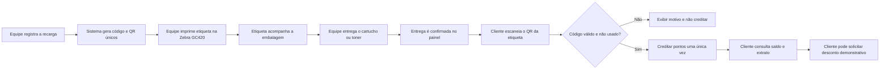

# Jornada do cliente e regras de pontos

## Jornada proposta



## Cálculo da pontuação

```text
pontos = arredondar para baixo(valor da recarga × pontos por real)
```

Na configuração inicial do protótipo, a taxa é **2 pontos por R$ 1,00**. Uma recarga de R$ 50,00 representa 100 pontos. O painel permite ajustar a taxa; recargas novas usam o valor salvo, enquanto os pontos já registrados permanecem como histórico.

## Resgate demonstrativo

O protótipo representa a conversão fixa de **100 pontos por R$ 1,00 de desconto**. O resgate utiliza blocos completos de 100 pontos e apenas altera o saldo ilustrativo local. Não cria cupom ou autorização financeira.

## Regras do QR

1. Cada recarga recebe um token aleatório exclusivo.
2. O token aparece no QR Code e no painel para a demonstração manual.
3. A equipe imprime a etiqueta na impressora Zebra GC420 instalada no computador local; a janela de impressão permite selecionar o driver Zebra.
4. A largura e a altura no protótipo devem ser ajustadas para a etiqueta carregada e para as preferências do driver. O padrão de 50 × 30 mm é apenas uma sugestão editável, não uma confirmação do tamanho do rolo da Ecojet. O layout demonstrativo aceita de 45 a 108 mm de largura por 26 a 250 mm de altura.
5. A etiqueta acompanha o cartucho/toner durante a entrega.
6. A confirmação da entrega é pré-requisito para liberar pontos.
7. A primeira confirmação válida marca o token como utilizado e credita os pontos uma única vez.
8. Um QR desconhecido, já utilizado ou ainda não entregue não libera pontos.

Na implementação atual essas regras são executadas apenas no navegador. Uma pessoa pode alterar o conteúdo de `localStorage`; portanto, o mecanismo ilustra o fluxo e não é prova segura de entrega nem prevenção robusta a fraude.

## Impressora e etiqueta

O fluxo previsto usa uma impressora de etiquetas Zebra GC420 instalada no computador local. Nesta versão, a aplicação prepara uma página do tamanho informado e usa a caixa de impressão padrão do navegador; a pessoa escolhe a impressora e revisa as opções do driver. A aplicação não detecta automaticamente se a impressora está conectada nem garante que o driver ou mídia estejam configurados.

Antes de imprimir etiquetas reais, confirmar com a Ecojet a variante exata da impressora (GC420d ou GC420t), a dimensão e o tipo de mídia (gap, marca preta ou contínua), a orientação e a calibração do driver. Consulte a documentação Zebra para [GC420d](https://www.zebra.com/content/dam/support-dam/en/documentation/unrestricted/guide/product/gc420d-ug-en.pdf), [especificações GC420](https://www.zebra.com/content/dam/zebra_new_ia/en-us/solutions-verticals/product/Printers/Desktop%20Printers/G-Series%20GC%20Desktop%20Printers/GENERAL/documents/gc20d-t-tech-specs.pdf) e [calibração da série G](https://support.zebra.com/article/G-Series-GC-Models-Calibrating-the-Printer).

## Dúvidas para validar com a Ecojet

- O cliente confirma recebimento por QR, link, código impresso ou uma combinação desses meios?
- Qual evento operacional comprova a entrega: baixa do motoboy, confirmação do cliente ou ambos?
- Qual taxa de pontos por real é financeiramente viável e quem pode alterá-la?
- Os pontos expiram? Há validade mínima, limite por pedido ou tratamento de devoluções?
- Como funcionará o desconto: em qual serviço, com quais limites e como o caixa o reconhecerá?
- Como tratar duas recargas no mesmo pedido, troca de cartucho ou entrega sem acesso à internet?
- Quais informações do cliente são necessárias e por quanto tempo serão mantidas?

## Página de regulamento demonstrativo

O protótipo disponibiliza a página [`../regulamento.html`](../regulamento.html), com as regras já ilustradas e os pontos ainda pendentes de decisão. O texto esclarece que o protótipo não é um serviço comercial oficial, não cria benefício real e não deve ser usado para cadastrar dados verdadeiros. As condições operacionais e comerciais devem ser aprovadas pela Ecojet antes de qualquer uso real.
