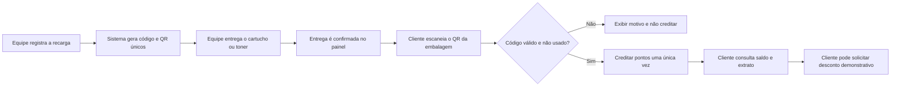

# Jornada do cliente e regras de pontos

## Jornada proposta



## Cálculo da pontuação

```text
pontos = arredondar para baixo(valor da recarga × pontos por real)
```

Na configuração inicial do protótipo, a taxa é **2 pontos por R$ 1,00**. Uma recarga de R$ 50,00 representa 100 pontos. O painel permite ajustar a taxa; recargas novas usam o valor salvo, enquanto os pontos já registrados permanecem como histórico.

## Resgate demonstrativo

O protótipo representa a conversão fixa de **100 pontos por R$ 1,00 de desconto**. O resgate utiliza blocos completos de 100 pontos e apenas altera o saldo ilustrativo local. Não cria cupom ou autorização financeira.

## Regras do QR

1. Cada recarga recebe um token aleatório exclusivo.
2. O token aparece no QR Code e no painel para a demonstração manual.
3. A confirmação da entrega é pré-requisito para liberar pontos.
4. A primeira confirmação válida marca o token como utilizado e credita os pontos uma única vez.
5. Um QR desconhecido, já utilizado ou ainda não entregue não libera pontos.

Na implementação atual essas regras são executadas apenas no navegador. Uma pessoa pode alterar o conteúdo de `localStorage`; portanto, o mecanismo ilustra o fluxo e não é prova segura de entrega nem prevenção robusta a fraude.

## Dúvidas para validar com a Ecojet

- O cliente confirma recebimento por QR, link, código impresso ou uma combinação desses meios?
- Qual evento operacional comprova a entrega: baixa do motoboy, confirmação do cliente ou ambos?
- Qual taxa de pontos por real é financeiramente viável e quem pode alterá-la?
- Os pontos expiram? Há validade mínima, limite por pedido ou tratamento de devoluções?
- Como funcionará o desconto: em qual serviço, com quais limites e como o caixa o reconhecerá?
- Como tratar duas recargas no mesmo pedido, troca de cartucho ou entrega sem acesso à internet?
- Quais informações do cliente são necessárias e por quanto tempo serão mantidas?
